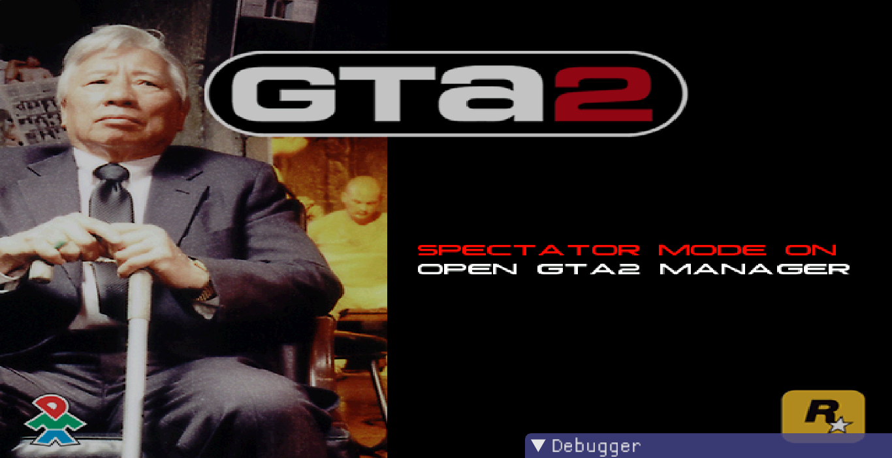

# Adding new pages to Frontend (WIP)

In this example we will create a new page for the Frontend: an **options menu page**. Instead of just opening GTA2 manager, we will create a menu with two options: one sets a global boolean flag, while the other opens the GTA2 manager.

We can summarize the addition of pages on the following list:

- Increase the limit of pages (if needed)
- Add an enum for the new page
- Set your page: number of elements, options, their position on the screen etc
- Set the background scene for the new page
- Set what your keyboards keys should do in that page (ESC, left/right arrows etc)
- Configure the horizontal selection of an item (if there is one)

## Increasing the limit of pages

First you probably need to increase the limit of Frontend pages. The original has a limit of 17 pages, and most of them are already used. Originally in `Frontend.hpp` we have

```c
struct Frontend
{
    // ...
    MenuPage field_136_menu_pages_array[17];
    // ...
}
```
You should change it to something like
```c
struct Frontend
{
    // ...
    MenuPage field_136_menu_pages_array[30];
    // ...
}
```

## Adding an enum for the new page

Since we will refer to the new page index many times it's important to set an enum for it. We will call it `MENUPAGE_OPTIONS_16` and add in `MenuPages` enum in `Frontend.hpp`:

```c
enum MenuPages
{
    // ...
    MENUPAGE_OPTIONS_16 = 16,   // new page
}
```

## Setting our page

```c hl_lines="7"
Frontend::SetupMenuStringsOptionsElements()
{
    // ...
    wcsncpy(pPage->field_4_options_array[1].field_6_option_name_str,
            gText_0x14_704DFC->Find_5B5F90("options"),
            0x32u);
    pPage->field_4_options_array[1].field_80_menu_page_target = MENUPAGE_GTA2MANAGER;
    // ...
}
```
We change it to
```c hl_lines="7"
Frontend::SetupMenuStringsOptionsElements()
{
    // ...
    wcsncpy(pPage->field_4_options_array[1].field_6_option_name_str,
            gText_0x14_704DFC->Find_5B5F90("options"),
            0x32u);
    pPage->field_4_options_array[1].field_80_menu_page_target = MENUPAGE_OPTIONS_16; // changed
    // ...
}
```
Now if the user clicks `OPTIONS` in main menu, he will arrive at our new page.

Now / `gSpectator`  /

using the function `gText_0x14_704DFC->Find()`. But if you want to skip it (setting the same label for all languages) you just place a literal wide string like `L"OPEN GTA2 MANAGER"`.


```c linenums="1"
Frontend::SetupMenuStringsOptionsElements()
{
    // ...
    // Options Page //

    // Main settings of the page:
    pPage = &field_136_menu_pages_array[MENUPAGE_OPTIONS_16]; // set the pPage pointer to our page
    pPage->field_0_number_of_options = 2; // set the number of options
    pPage->field_2_number_of_elements = 0; // no elements for now
    pPage->field_BC6_current_option_idx = 0; // Clear
    pPage->field_BC8_default_option_idx = 0; // Set the selecting item when the user enter the page

    ////////////////////////////////
    // Spectator Mode menu option //
    
    // select something using left/right arrows: 
    // use HORIZONTAL_SELECTION_2 type
    pPage->field_4_options_array[0].field_0_option_type = HORIZONTAL_SELECTION_2;
    pPage->field_4_options_array[0].field_2_x_pos = 300; // set the x position of the menu option
    pPage->field_4_options_array[0].field_4_y_pos = 250; // set the y position of the menu option
    pPage->field_4_options_array[0].field_7E_horizontal_max_idx = 1; // total number of options minus 1
    pPage->field_4_options_array[0].field_6E_horizontal_selected_idx = gSpectator; // set the selected option

    // Set the option text. It uses wchar_t
    wcsncpy(pPage->field_4_options_array[0].field_6_option_name_str,
            L"SPECTATOR MODE",
            50);

    // Enable all options (OFF and ON in this case).
    u16 enabled_idx3 = 0;
    do
    {
        pPage->field_4_options_array[0].field_72_horizontal_idx_enabled[enabled_idx3++] = 1;
    } while (enabled_idx3 <= pPage->field_4_options_array[0].field_7E_horizontal_max_idx);

    pPage->field_B8A_option_states[0].field_0_unused = 280;
    pPage->field_B8A_option_states[0].field_2_unused = 163;
    
    //////////////////////////////
    // Open GTA2 manager option //

    // User can press ENTER to go to another page:
    // Use ENTERABLE_1 type
    pPage->field_4_options_array[1].field_0_option_type = ENTERABLE_1; 
    pPage->field_4_options_array[1].field_2_x_pos = 300; // Set the text position
    pPage->field_4_options_array[1].field_4_y_pos = 270;

    // Set the option text
    wcsncpy(pPage->field_4_options_array[1].field_6_option_name_str,
            L"OPEN GTA2 MANAGER",
            50);
    pPage->field_4_options_array[1].field_80_menu_page_target = MENUPAGE_GTA2MANAGER; // Target page
}
```

Note that `MENUPAGE_GTA2MANAGER` is not actually a frontend page but it triggers the GTA2 manager to open.


## Setting the background scene for the new page

Now we need to configure which background will be displayed on the new page. This is what function `Frontend::UpdateMenuScreen` do. In our case we will keep the options screen by using `Options_0` from enum `MenuScreen`.

We just need to add another `else if` checking if the current page is `MENUPAGE_OPTIONS_16` and then set `field_EE08_menu_screen = Options_0`:

```c linenums="1" hl_lines="23 24 25 26 27"
void Frontend::UpdateMenuScreen_4B6780()
{
    MenuPage* pMenuPage = &field_136_menu_pages_array[field_132_current_page_idx];
    if (field_110_state != FrontendState::Booting_Map_2)
    {
        if (field_132_current_page_idx == MENUPAGE_START_MENU)
        {
            // ...
        }
        else if (field_132_current_page_idx == MENUPAGE_PLAY)
        {
            // ...
        }
        else if (field_132_current_page_idx == MENUPAGE_VIEW_HIGH_SCORE)
        {
            field_EE08_menu_screen = HiScoresDisplay_12;
        }
        // ...
        else if (field_132_current_page_idx == MENUPAGE_CREDITS)
        {
            field_EE08_menu_screen = Credits_17;
        }
        // We add another "else if" here:
        else if (field_132_current_page_idx == MENUPAGE_OPTIONS_16) // here is our new page
        {
            field_EE08_menu_screen = Options_0; // Options background screen: the old man with a stick
        }
        else
        {
            // default screen
            field_EE08_menu_screen = PlayArea1_7;
        }
    }
}
```

## Setting what our keyboards keys should do in that page

First we need to set what page we arrive when pressing ESC. Since in our case our new page is an options page, then pressing ESC we should return to the initial page (play, options, quit), which is the page `MENUPAGE_START_MENU`. 

Then we go to the function `Frontend::UpdatePageFromUserInput`. On `escape_pressed` we look for the case which goes to `MENUPAGE_START_MENU` and add our switch case there:

```c linenums="1" hl_lines="16"
if (field_C9D1_escape_pressed)
{
    switch (field_132_current_page_idx)
    {
        case MENUPAGE_START_MENU:
        case MENUPAGE_PARENTAL_CONTROL:
            ChangeMenuPage_4B3170(MENUPAGE_CREDITS);
            break;
        case MENUPAGE_PLAY:
        case MENUPAGE_DEAD:
        case MENUPAGE_AREA_COMPLETE:
        case MENUPAGE_GAME_COMPLETE:
        case MENUPAGE_BONUS_AREA:
        case MENUPAGE_NICE_TRY:
        case MENUPAGE_RESULTS_PLAYER_QUIT:
        case MENUPAGE_OPTIONS_16:  // we add our page here
            ChangeMenuPage_4B3170(MENUPAGE_START_MENU);
            break;
        case MENUPAGE_VIEW_HIGH_SCORE:
            ChangeMenuPage_4B3170(MENUPAGE_PLAY);
            break;
        default:
            field_108_winmain_next_state = Quit_1;
            break;
    }
    snd1_67D818.field_0_object_type = 6;
}
```

Now we need to configure what happens when we press the right or left arrow buttons:

```c linenums="1" hl_lines="12-21 40-49"
if (field_C9CC_left_pressed) // set what happens when pressing the left arrow button
{
    current_option_idx = pMenuPage->field_BC6_current_option_idx;
    pOption_prev = &pMenuPage->field_4_options_array[current_option_idx];
    if (pOption_prev->field_0_option_type == HORIZONTAL_SELECTION_2)
    {
        bWrapped_prev = pOption_prev->SelectPrevHorizontalIdx_4B6390(); // True if the selection has changed after pressing the left arrow

        /// .....
        /// .....

        // Add our case here:
        // Since in this case there are only 2 options, pressing left will always result in index 0
        if (field_132_current_page_idx == MENUPAGE_OPTIONS_16 && option_idx == 0)
        {
            gSpectator = false; // Do whatever you want here. In this case, set the global to 0
            if (bWrapped_prev)
            {
                snd1_67D818.field_0_object_type = 3; // If the selection has changed, set the audio
            }
        }
        pMenuPage = pMenuPageSaved;
    }
    else if (field_132_current_page_idx == MENUPAGE_PLAY)
    {
        // ....
    }
}
else if (field_C9CD_right_pressed)  // Now set what happens when pressing the right arrow button
{
    option_idx = pMenuPage->field_BC6_current_option_idx;
    pOption_next = &pMenuPage->field_4_options_array[option_idx];
    if (pOption_next->field_0_option_type == HORIZONTAL_SELECTION_2)
    {
        bWrapped_next = pOption_next->SelectNextHorizontalIdx_4B6330(); // True if the selection has changed after pressing the right arrow
        
        /// .....
        /// .....

        // Add our case here:
        // Since in this case there are only 2 options, pressing right will always result in index 1
        if (field_132_current_page_idx == MENUPAGE_OPTIONS_16 && option_idx == 0)
        {
            gSpectator = true; // Do whatever you want here. In this case, set the global to 1
            if (bWrapped_next)
            {
                snd1_67D818.field_0_object_type = 4; // If the selection has changed, set the audio
            }
        }
        pMenuPage = pMenuPageSaved;
    }
    else if (field_132_current_page_idx == MENUPAGE_PLAY)
    {
        // ...
    }
}
```

## Configuring the horizontal selection

`Frontend::GetOptionText` / 

```c linenums="1"  hl_lines="14-26"
void Frontend::GetOptionText_4B3AF0(u16 menu_page_idx, u16 option_idx, wchar_t** w_buffer)
{
    MenuPage* pPage = &field_136_menu_pages_array[menu_page_idx];
    MenuItem* pOption = &pPage->field_4_options_array[option_idx];

    if (menu_page_idx == MENUPAGE_PLAY && option_idx == 0) // option 0 = change player/name
    {
        // ...
    }
    else if (menu_page_idx == MENUPAGE_VIEW_HIGH_SCORE && option_idx == 0)
    {
        swprintf(gTmpWideStr_67C7D8, L"%s", gText_0x14_704DFC->Find_5B5F90("hi_for"));
    }
    // Here we include what should be displayed
    else if (menu_page_idx == MENUPAGE_OPTIONS_16 && option_idx == 0)
    {
        if (pOption->field_6E_horizontal_selected_idx == 0)
        {
            swprintf(tmpBuff_67BD9C, L"OFF");
        }
        else
        {
            swprintf(tmpBuff_67BD9C, L"ON");
        }
        swprintf(gTmpWideStr_67C7D8, L"%s %s", pOption->field_6_option_name_str, tmpBuff_67BD9C);
    }
    // leave the default option as it is: the index of the selected item
    else
    {
        swprintf(tmpBuff_67BD9C, L"%d", pOption->field_6E_horizontal_selected_idx);
        swprintf(gTmpWideStr_67C7D8, L"%s %s", pOption->field_6_option_name_str, tmpBuff_67BD9C);
    }
    *w_buffer = (wchar_t*)&gTmpWideStr_67C7D8;
}
```

## Final result



